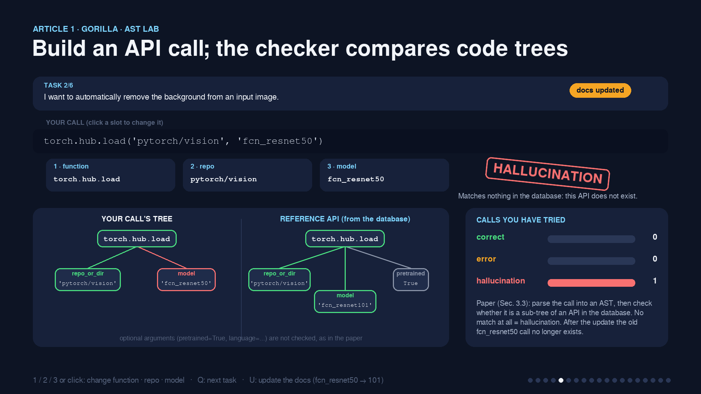
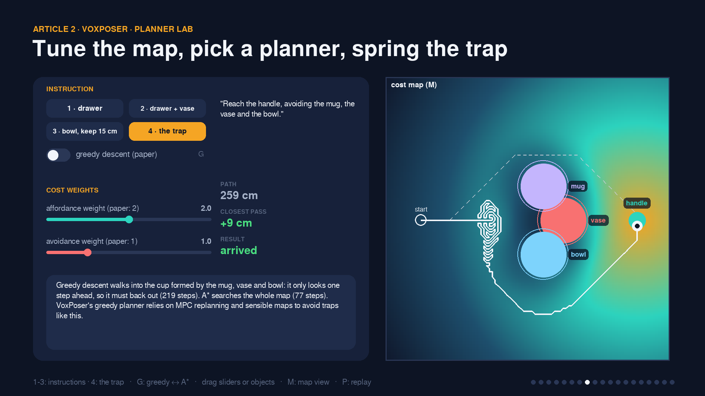
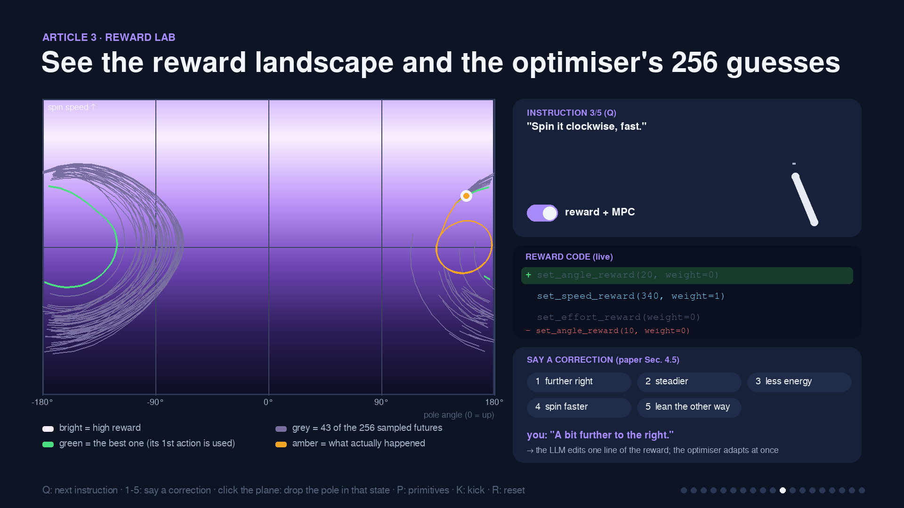
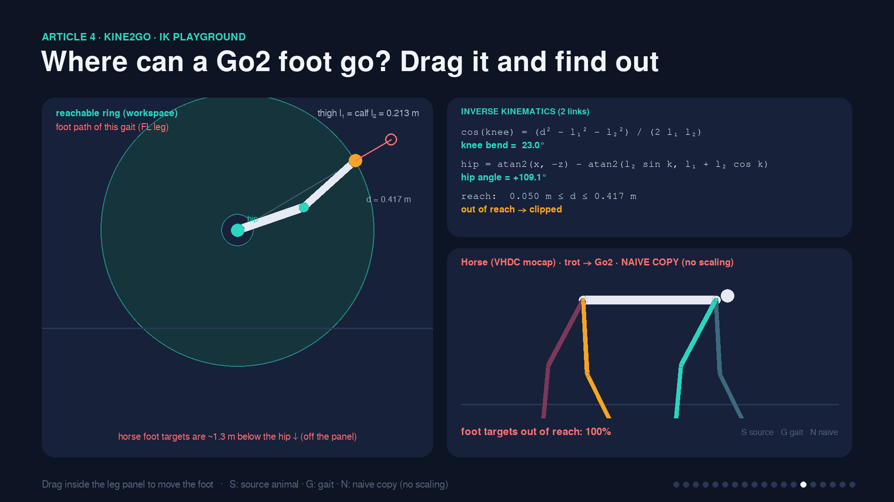

# Reading 7: From Words to Motors

**ENG 6010: Artificial Intelligence in Robotics**

Four papers on connecting large language models (LLMs) to robots, explained with an **interactive Python slideshow** that runs a small working demo of each paper's core idea, plus a written summary of each article.

| # | Article | The bridge between language and the robot |
|---|---|---|
| 1 | **Gorilla**: LLMs connected with massive APIs (Patil et al., 2023) | an API call |
| 2 | **VoxPoser**: composable 3D value maps (Huang et al., CoRL 2023) | a 3D value map |
| 3 | **Language to Rewards** for robotic skill synthesis (Yu et al., 2023) | a reward function |
| 4 | **Kine2Go**: kinematic dataset for the Unitree Go2 (Pałucki et al., 2026) | motion data (states + motor actions) |

📄 **[Article_Summaries.md](Article_Summaries.md)**: what each article does and what I learned from it.

---

## The interactive slideshow

```bash
cd readings/Reading_7
python presentation/interactive_presentation.py              # windowed
python presentation/interactive_presentation.py --fullscreen
```

**Navigation:**

| Key | Action |
|---|---|
| → / Space | next slide |
| ← | previous slide |
| F | fullscreen |
| Esc | quit |

Each slide lists its own keys along the bottom of the screen. It renders at your screen's native resolution, so it stays sharp at any size.

| # | Slide | What it looks like · what you can do |
|---|---|---|
| 1 | From Words to Motors | Letters of an instruction fall through four layers and turn into a motor waveform · click a layer |
| 2 | The key link | A subway line with five stations (language → API call → value map → reward → motor data) · click a station / 1-5 to see what travels there |
| 3 | Gorilla: the idea | A chat app replays the paper's Figure 1 (GPT-4 / Claude / Gorilla) with verdict stamps; machines on a belt build Gorilla (1,645 docs → 16,450 pairs → LLaMA-7B) |
| 4 | **Gorilla: the retriever** | **BM25 heatmap**: every query word × every API doc · Q: next prompt · **T: type your own** · click a row |
| 5 | **Gorilla: AST lab** | **Build a call** from three slots (1/2/3), see **your call's tree vs the reference tree**, verdict stamp + tally · Q: task · U: update the docs |
| 6 | Gorilla results | Accuracy-vs-hallucination **scatter** (paper Table 1); dots glide when you switch retriever (R) or hub (H) |
| 7 | VoxPoser: the idea | Code lines light up and reshape a **rotatable 3D value surface** (drag / A, D) · R: replay |
| 8 | **VoxPoser planner lab** | **Greedy vs A\*** (G), **weight sliders**, drag objects, **4: the cup-shaped trap** that catches greedy descent · M: map view |
| 9 | VoxPoser results | Paper's real-robot trials as a dot matrix + a **waffle of my 300 scenes** per condition (1-4) |
| 10 | Language to Rewards: the idea | The **Motion Descriptor template fills its slots**, the Reward Coder types code, a pendulum starts moving · 1-5: instruction |
| 11 | **Language to Rewards: reward lab** | **Phase-plane reward landscape + the optimiser's 256 sampled futures** · 1-5: **say a correction** (code diff shown) · click the plane to drop the pole · P: primitives |
| 12 | Language to Rewards results | Rings (paper 90% vs 50%), my task matrix, horizon curve, the impossible request, moonwalk chat (N) |
| 13 | Kine2Go: the idea | A **factory belt**: 40 clips → retarget → RL gym → 20 rollouts each → 800 trajectories · click a station · +/- speed |
| 14 | **Kine2Go IK playground** | **Drag the foot**; the workspace ring and the law-of-cosines solution update · S: source · G: gait · N: naive copy |
| 15 | **Kine2Go reward kernels** | **Six sliders**, six exp(−k·e²) curves, stacked total reward, robot that ends the episode past 1 m / 90° |
| 16 | Kine2Go dataset | Rollout field + **heading rose** + logged-frame inspector · click to add a rollout · M: motion |
| 17 | Connections | 5 questions × 4 papers board · click or hover a cell for the evidence |
| 18 | Quiz | "Which bridge would you build?" · 1-4: answer · N: next |
| 19 | Takeaway | |






---

## How the code relates to each article

There is no LLM in this project: everything runs offline on a laptop CPU. Where a paper's LLM would write something (a program, a motion description, reward code), the demo shows a hand-written example in that paper's format and labels it as an example. The parts *around* the LLM are implemented for real.

| Article | Module | What is implemented | What is simplified |
|---|---|---|---|
| Gorilla | `demos/gorilla_demo.py` | APIBench-style API database · **BM25 retriever** · the paper's **AST sub-tree matching** (correct / error / hallucination) · test-time documentation change | 15 hand-picked APIs instead of 1,645; stand-ins for the fine-tuned model |
| VoxPoser | `demos/voxposer_demo.py` | affordance maps (distance transform), avoidance maps (Gaussian), the paper's cost weights (2 and 1), **greedy planner**, **closed-loop MPC replanning**, plus an A\* planner and a local-minimum "trap" scene for comparison | 2-D 100 × 100 slice instead of 100³; a perception stub instead of OWL-ViT / SAM / XMem |
| Language to Rewards | `demos/l2r_demo.py` | reward API with terms R = −Σ w·r² (paper Eq. 1), executing "Reward Coder" code, **Predictive Sampling MPC** (MJPC's planner), a Code-as-Policies primitives baseline | the Pendulum-v1 robot instead of a quadruped or a dexterous hand |
| Kine2Go | `demos/kine2go_demo.py` | gait references, **retargeting with inverse kinematics**, the paper's **imitation reward (Eqs. 1-8)** with its weights and scales, termination rule, random-heading rollouts | 2-D side view (8 joints instead of 12); a noisy tracker instead of a PPO policy |

### Results of my demos (`python evaluate.py`, about 2 minutes)

| Demo | Result |
|---|---|
| Gorilla | BM25 picked the right doc for 5 of 6 prompts; it failed on the numeric-constraint prompt (it matches words, not numbers). After the documentation update, the retriever-aware stand-in was **correct**; the memorising stand-in's old call became a **hallucination**. |
| VoxPoser (300 random scenes) | Clean arrival: 43% with the affordance map only → **93%** with the avoidance map. With the target moved mid-way: 6% when following the first plan vs **88%** when replanning every step (MPC). |
| Language to Rewards (10 starts each) | Reward + MPC solved **4 of 4 feasible tasks** (100% each); fixed primitives solved 2 (no skill for "lean" or "spin"). The impossible "hold horizontal" request settled at 156.5°, the closest holdable pose (theory 156.4°). Swing-up success vs horizon: 100% at 10–30 steps, 70% at 40, 0% at 60. |
| Kine2Go | Naive copy (no scaling): **100%** of horse foot targets unreachable, 52–80% for the dog; with scaling + IK: **0%**. Imitation reward vs joint error: 100% → 84% (5°) → 43% (20°) of the maximum. |

All numbers are saved in `results/summary.json`, and the slides read them from there.

---

## Folder layout

```
Reading_7/
├── README.md                  this file
├── Article_Summaries.md       what each article does and what I learned (assignment document)
├── requirements.txt           numpy + pygame-ce (Python 3.12 - 3.15)
├── run_presentation.bat       Windows one-click: sets up .venv, then starts the slideshow
├── Reading_7.sln / .pyproj    Visual Studio solution (Ctrl+F5 runs the slideshow)
├── evaluate.py                runs every demo's evaluation -> results/summary.json
├── demos/
│   ├── gorilla_demo.py        Article 1
│   ├── voxposer_demo.py       Article 2
│   ├── l2r_demo.py            Article 3
│   └── kine2go_demo.py        Article 4
├── presentation/
│   ├── interactive_presentation.py   entry point (19 slides)
│   ├── engine.py              native-resolution rendering engine (from Readings 6)
│   ├── slides_overview.py · slides_gorilla.py · slides_voxposer.py
│   ├── slides_l2r.py · slides_kine2go.py · slides_closing.py
│   ├── screenshots/           preview images
│   └── icons/
└── results/summary.json       numbers shown on the slides
```

---

## Setup

Only **NumPy** and **pygame-ce** are needed. There is no PyTorch this time, so Python 3.12 to 3.15 all work, including 3.15.

**Visual Studio (Windows):**
1. Double-click `run_presentation.bat` once. It creates `.venv`, installs the two packages and starts the slideshow; press Esc to close it.
2. Open `Reading_7.sln` and press **Ctrl+F5**.

To make it start fullscreen, put `--fullscreen` in **Project → Properties → Debug → Script Arguments**.

**Any terminal:**
```bash
cd readings/Reading_7
python -m venv .venv
.venv\Scripts\activate             # macOS/Linux: source .venv/bin/activate
pip install -r requirements.txt
python presentation/interactive_presentation.py
python evaluate.py                 # optional: recompute results/summary.json
```
