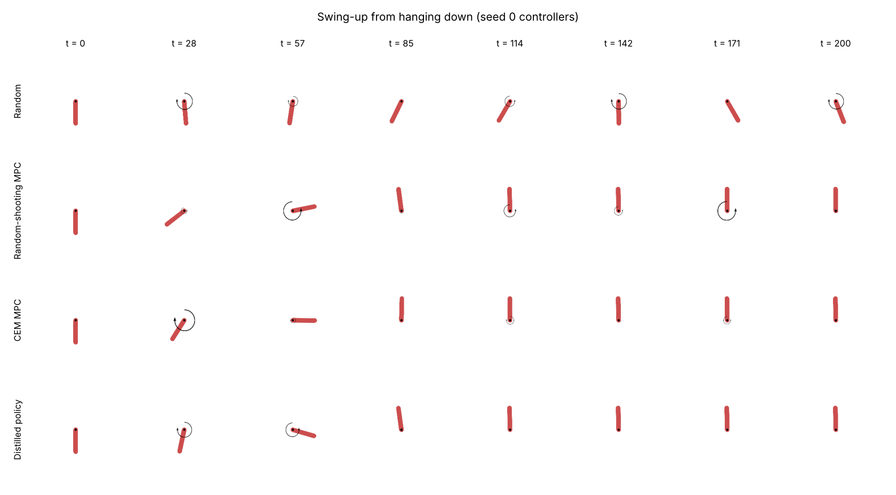
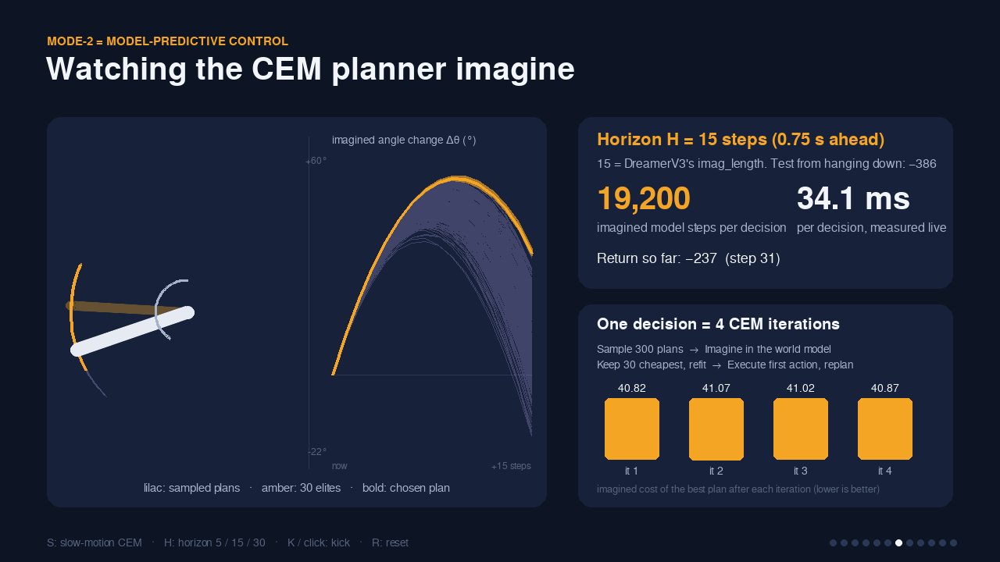
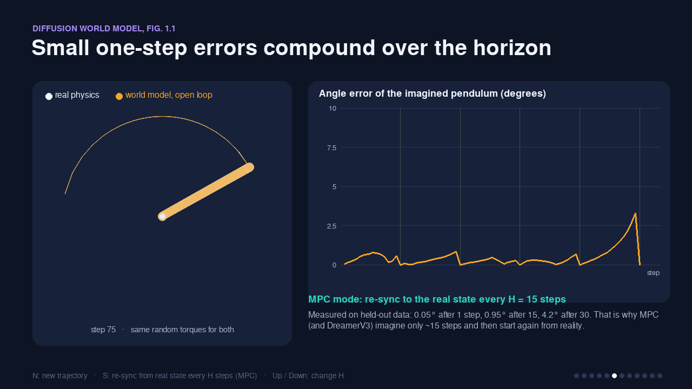
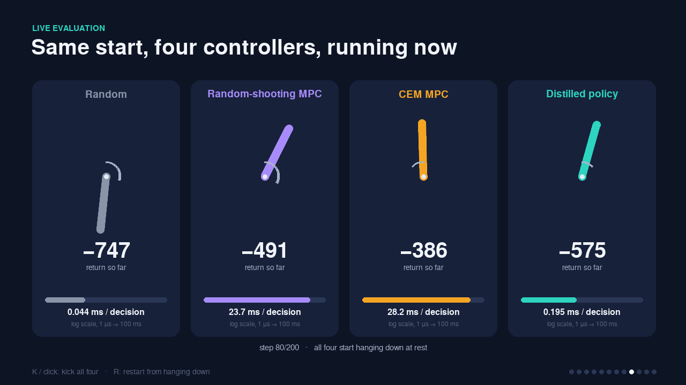

# Readings 6: Mode-2 to Mode-1, Planning with a Learned World Model and Distilling It into a Fast Policy

**ENG 6010: Artificial Intelligence in Robotics**

This project is a small, CPU-only experiment on Gymnasium's `Pendulum-v1`. It turns the main idea shared by this week's readings into running code:

1. **Learn a world model** of the pendulum from random interaction data.
2. **Plan with it (Mode-2).** At every step, a Cross-Entropy Method (CEM) planner searches 15-step action sequences *inside the learned model*, scores them with a fixed cost function, executes only the first action and then replans. This is Model-Predictive Control (MPC).
3. **Compile the planner into a reflex (Mode-1).** A small neural-network policy is trained to imitate the planner, using behaviour cloning followed by DAgger.
4. **Compare** a random policy, random-shooting MPC, CEM MPC and the distilled policy on both **return** and **time per decision**.

**Headline result (3 seeds, 15 test episodes per controller):** the distilled Mode-1 policy scores **−173.5 ± 75.5**, against **−155.0 ± 50.3** for the CEM planner it imitates (random play scores −1171.7 ± 258.7). That keeps **98%** of the planner's improvement over random. It decides in **0.096 ms** instead of **41.3 ms**, about **430× faster**. See [Results.md](Results.md) for the numbers and plots, and [Program_Explanation.md](Program_Explanation.md) for a full walkthrough of the program.



---

## How the code connects to the four readings

| Reading | Idea used here | Where in the code |
|---|---|---|
| **LeCun (2022), *A Path Towards Autonomous Machine Intelligence*** | **Mode-2**: perception, then planning with a world model and a fixed *intrinsic cost*, then acting. The agent executes only the first action of the optimised sequence and replans (MPC). **Mode-1**: a fast reactive policy. **Fig. 5**: Mode-2 plans are used to train ("compile") the Mode-1 actor. | `cost.py` (intrinsic cost), `planner.py` (Mode-2 CEM MPC), `policy.py` (Mode-1 distillation) |
| **Ding et al. (2024), *Diffusion World Model* (arXiv 2402.03570)** | One-step world models accumulate error when they are rolled out on their own predictions (**compounding error**, their Fig. 1.1). Imagined rollouts are used only during *training*, so the *deployed* policy stays cheap. | `world_model.multi_step_error()` and the `prediction_error_vs_horizon.png` plot; the decision-time comparison |
| **Hafner et al. (2023), *DreamerV3* (arXiv 2301.04104)** | A learned world model trained from experience, short imagined rollouts (**15 steps**), and the **symlog** transform for robust regression targets. | `config.plan_horizon = 15`, `utils.symlog/symexp`, `--symlog` flag in `world_model.py` |
| **DreamerV3 GitHub repo (danijar/dreamerv3)** | `symlog`/`symexp` in `embodied/jax/nets.py`; `imag_length: 15` and all hyperparameters kept in one `configs.yaml`. | `utils.py` (same two functions), `config.py` (all settings in one file) |

---

## Folder layout

```
Readings_6/
├── README.md               this file
├── Program_Explanation.md  written explanation of the program (assignment section)
├── Results.md              plots, results table and discussion (assignment section)
├── Readings_6_Presentation.pptx  15-slide static deck: how the code works and how it ties to the readings
├── presentation/
│   ├── interactive_presentation.py  the live, animated talk (pygame): models run on the slides
│   ├── make_presentation.py      builds the .pptx with python-pptx from results/summary.json
│   ├── screenshots/              previews of the interactive slides
│   └── icons/                    slide icons (PNG)
├── requirements.txt        pinned package versions
├── Readings_6.sln / .pyproj  Visual Studio solution: open it and press Ctrl+F5 to run the presentation
├── run_presentation.bat    Windows one-click: sets up .venv the first time, then starts the presentation
├── config.py               every hyperparameter in one place (like DreamerV3's configs.yaml)
├── utils.py                symlog/symexp, seeding, decision-time stopwatch, env factory
├── cost.py                 fixed Pendulum cost = LeCun's "intrinsic cost"
├── collect_data.py         random controller, episode rollouts, dataset saving (.npz)
├── world_model.py          MLP dynamics model f(s,a) -> s'-s, training, multi-step error test
├── planner.py              Mode-2 MPC: CEM planner and random-shooting baseline
├── policy.py               Mode-1 policy network and BC + DAgger distillation
├── evaluate.py             runs controllers on unseen start states; return + timing stats
├── plots.py                all matplotlib figures
├── main.py                 the whole pipeline end to end: `python main.py`
└── results/
    ├── summary.json                     every final number from the reported run
    ├── world_model_loss.png             train/validation loss of the world model
    ├── prediction_error_vs_horizon.png  compounding error, horizons 1-30
    ├── return_comparison.png            mean ± std return of the 4 controllers
    ├── decision_time_comparison.png     ms per decision (log scale)
    ├── distillation_dagger.png          policy return after BC and each DAgger iteration
    ├── swingup_filmstrip.png            rendered frames of each controller
    ├── gifs/*.gif                       one swing-up animation per controller
    ├── models/*.pt                      seed-0 world model and policy weights
    ├── console_log.txt                  console output of the reported run
    └── ablation_mbrl/                   earlier run with the model-based RL loop on (2 rounds)
```

`data/` (the random-transition `.npz` files) is regenerated on every run and is not committed (the repository's `.gitignore` excludes `data/`).

---

## Install and run

Use **Python 3.12, 3.13 or 3.14** (3.13 recommended; the reported run used 3.13 on CPU only). **Python 3.15 does not work yet** because PyTorch has no build for it. You can have several Python versions installed side by side; `run_presentation.bat` picks a compatible one automatically.

```bash
cd readings/Readings_6
python -m venv .venv && source .venv/bin/activate      # Windows: .venv\Scripts\activate
# Optional, much smaller download: CPU-only PyTorch
pip install torch==2.14.1 --index-url https://download.pytorch.org/whl/cpu
pip install -r requirements.txt

python main.py            # full experiment, 3 seeds, writes results/ (~11 min on 1 CPU thread)
python main.py --quick    # ~30 s smoke test, writes results_quick/ (not meaningful numbers)
python main.py --symlog   # same experiment with DreamerV3 symlog world-model targets
python main.py --mbrl-rounds 2   # turn on the model-based RL loop (collect with CEM, retrain)
python main.py --seeds 0  # a single seed
python main.py --no-gif   # skip rendering

python presentation/make_presentation.py   # rebuild Readings_6_Presentation.pptx from results/
```

---

## Interactive presentation

`python presentation/interactive_presentation.py` (add `--fullscreen` for presenting) opens the talk as a live Python app. The pendulums on the slides are simulated with the exact Pendulum-v1 physics and controlled *in real time* by the networks that `main.py` saved in `results/models/`. Every reported number is read from `results/summary.json`.

Navigation: **→ / Space** next, **←** back, **F** fullscreen, **Esc** quit. Each slide shows its own keys at the bottom.

| Slide | What is live | Interaction | Reading |
|---|---|---|---|
| Title | Distilled policy balancing the pendulum | Click / K: kick it | LeCun Mode-1 |
| Four readings | Cards animate in | Hover: where each idea lives in the code | all four |
| You are the controller | Pendulum-v1 with a live cost breakdown | Hold A / D for torque, T: hand over to the policy | LeCun intrinsic cost |
| Mode-2 thinks, Mode-1 reacts | Data flowing through both modes, 50 ms budget bar | 1 / 2 / 0: focus a mode | LeCun Mode-1/Mode-2 |
| Pipeline | The six stages light up in turn | Click a stage to pin it | all |
| Compounding error | Real pendulum vs the world model's open-loop guess | N: new run, S: re-sync every H steps (MPC), ↑/↓: H | DWM Fig. 1.1, DreamerV3 |
| Watching CEM imagine | All 300 imagined plans, the 30 elites and the chosen plan, on the pendulum and as angle vs time | S: slow-motion CEM iterations, H: horizon 5/15/30, K: kick | LeCun Mode-2, DreamerV3 `imag_length` |
| DAgger | Training loop animation, chart revealed per iteration | D: next iteration, A: all | LeCun Fig. 5 |
| The race | Random, random shooting, CEM and policy from the same start, live ms/decision | K / click: kick all four | DWM fast deployment |
| Results | Animated bars from `summary.json` | L: linear / log time axis | all |
| Back to the readings | Claim vs observed flip cards | 1-4 / click: flip | all |
| Takeaway | Policy balancing | Click: kick it, it recovers | LeCun Fig. 5 |







`python presentation/interactive_presentation.py --screenshots DIR` renders every slide to PNG without opening a window.

### Running it from Visual Studio (Windows)

The folder includes `Readings_6.sln` and `Readings_6.pyproj`, whose start file is the interactive presentation.

1. In the Visual Studio Installer, make sure the **Python development** workload is installed.
2. First time only: install Python 3.13 from python.org if you don't have 3.12-3.14, then double-click `run_presentation.bat`. It creates `.venv` with a compatible Python, installs the packages and opens the talk once (Esc to close).
3. Open `Readings_6.sln` in Visual Studio. In Solution Explorer, **Python Environments** should show `.venv` as the active environment.
4. Press **Ctrl+F5** (Start Without Debugging). F5 also works, but the debugger slows the planner slides.

To start fullscreen or on a given slide, put `--fullscreen` or `--start 7` in **Project → Properties → Debug → Script Arguments** (or press F in the running app). To run another script, right-click it in Solution Explorer → **Set as Startup File**.

VS Code users: open the `Readings_6` folder and use the entries in **Run and Debug** (from `.vscode/launch.json`).

All randomness (NumPy, PyTorch, environment start states, planner sampling) is seeded, so re-running gives the same returns. Decision times naturally depend on the CPU. PyTorch runs on a single thread (`config.torch_threads = 1`) so the timing comparison is fair and repeatable.

---

## What the program does, step by step

For each seed (0, 1, 2), `main.py` runs:

1. **Collect data** (`collect_data.py`). 50 episodes × 200 steps of uniformly random torques give 10,000 `(state, action, next_state, reward)` transitions, saved to `data/random_seed<k>.npz`. Ten more random episodes with different start states are kept aside as held-out trajectories.
2. **Train the world model** (`world_model.py`). A 3-layer MLP (128 units, SiLU) learns `Δs = f(s, a)` from normalised inputs and targets (optionally symlog targets), with a 90/10 train/validation split.
3. **Measure compounding error.** On the held-out trajectories, the model is given the true start state and the recorded actions and is rolled forward on its own predictions for 1-30 steps. The state RMSE and the angle error are recorded at every horizon.
4. **Mode-2 planning** (`planner.py`). CEM MPC plans 15-step torque sequences in the learned model (300 samples × 4 iterations, 30 elites, warm-started from the previous plan), scores them with the true Pendulum cost (`cost.py`), executes the first action and replans. An optional **model-based RL loop** (`--mbrl-rounds N`) runs CEM, adds the visited transitions to the dataset and retrains the model. It is off by default because in a 2-round test it did not change CEM's return at all (see `results/ablation_mbrl/`).
5. **Mode-1 distillation** (`policy.py`). A 2×64 tanh MLP policy is trained by behaviour cloning on 3 CEM episodes, then by 4 DAgger iterations. In each iteration the policy drives, the CEM planner labels every state the policy visited, the labels are added to the dataset, and the policy is retrained.
6. **Evaluate** (`evaluate.py`). Random, random-shooting MPC, CEM MPC and the distilled policy each run the same 5 unseen start states per seed (15 episodes in total). The episode return and the time spent inside `act(obs)` are recorded.

After all seeds, results are pooled, the plots and GIFs are generated (`plots.py`) and everything is written to `results/summary.json`.
