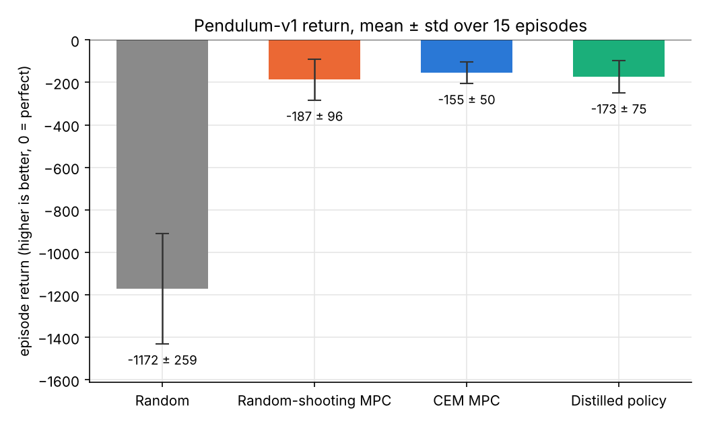
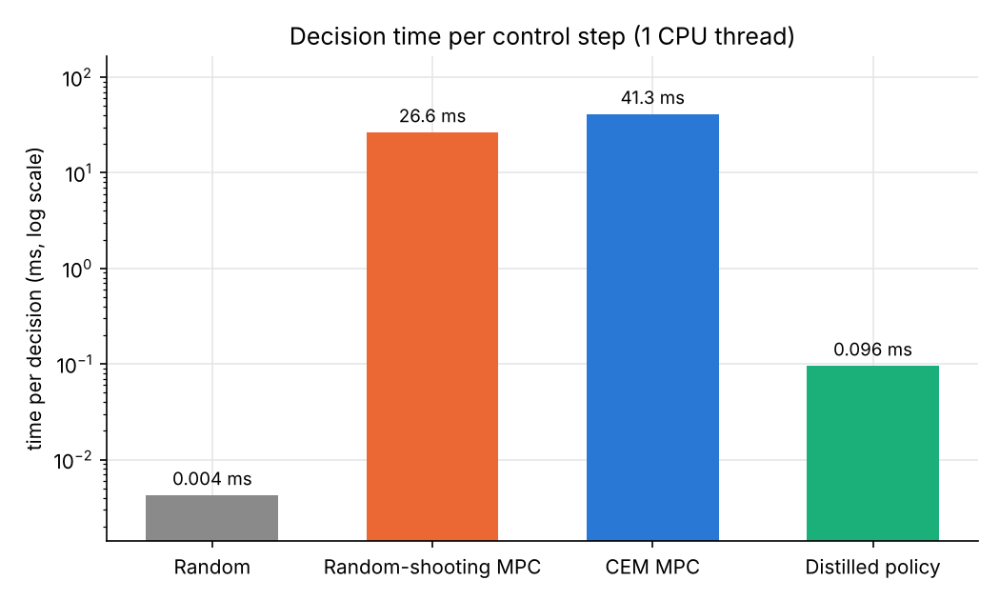
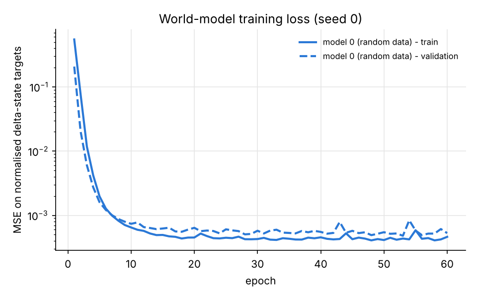
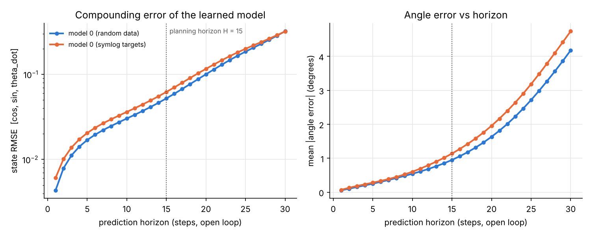
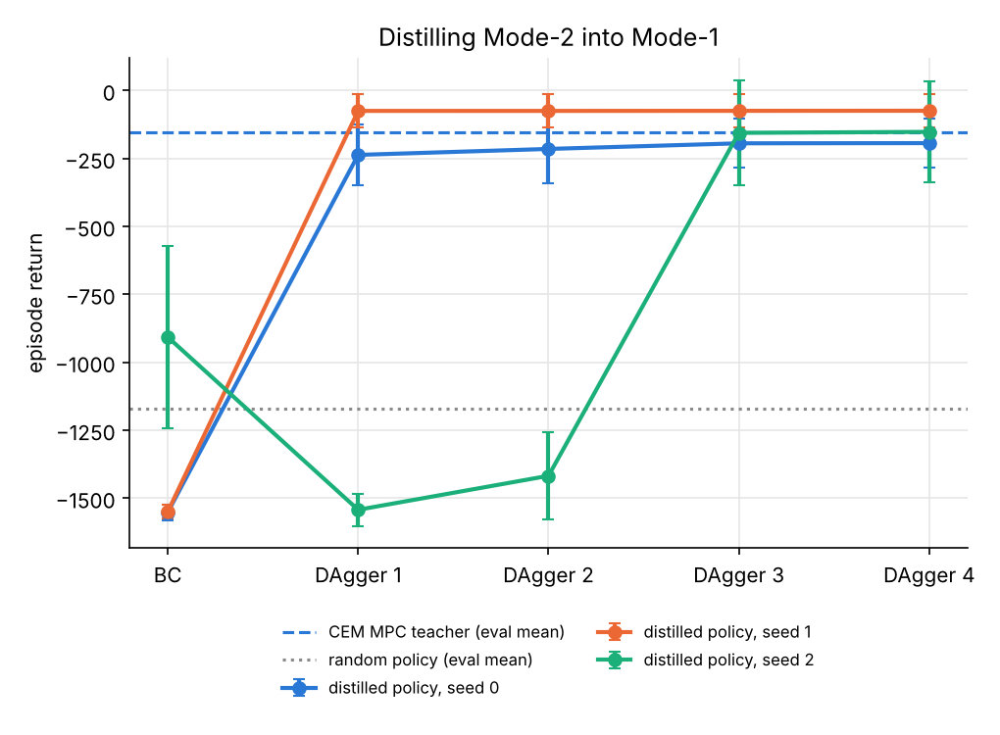

# Results

All numbers below come from one run of `python main.py` (3 seeds, Python 3.13, PyTorch 2.14.1, one CPU thread, 10.8 minutes in total). The raw values are in [`results/summary.json`](results/summary.json) and the console output is in [`results/console_log.txt`](results/console_log.txt). Each controller was tested on the same 5 unseen start states per seed, 15 episodes in total. Returns are sums of Pendulum rewards over 200 steps: 0 is perfect and higher is better.

## Main comparison

| Controller | Mode | Return (mean ± std, 15 ep.) | Per-seed mean return (seeds 0 / 1 / 2) | Decision time per step |
|---|---|---|---|---|
| Random | none | −1171.7 ± 258.7 | −1094.1 / −1231.4 / −1189.5 | 0.004 ms |
| Random-shooting MPC | Mode-2 | −187.4 ± 96.1 | −148.5 / −218.5 / −195.1 | 26.6 ms |
| **CEM MPC** | **Mode-2** | **−155.0 ± 50.3** | −149.7 / −169.5 / −145.9 | **41.3 ms** |
| **Distilled policy (BC + DAgger)** | **Mode-1** | **−173.5 ± 75.5** | −149.4 / −197.7 / −173.3 | **0.096 ms** |

Derived numbers (also in `summary.json` under `headline`):

- **Speed-up of Mode-1 over Mode-2:** 41.25 ms / 0.096 ms ≈ **430×** faster than CEM (277× faster than random shooting).
- **Performance kept:** (−173.5 − (−1171.7)) / (−155.0 − (−1171.7)) = **0.982**, so the distilled policy recovers 98.2% of the CEM planner's improvement over random play. In absolute terms it is 18.5 return points worse than CEM on average.

## World model

The world model trains quickly. On seed 0 the normalised MSE drops from about 0.5 to below 10⁻³ within 10 epochs and ends at 0.00046 (train) and 0.00053 (validation). The two curves stay close together, so the model is not overfitting the 10,000 random transitions. That is expected for a smooth, low-dimensional system with plenty of data.

| Open-loop horizon (steps) | 1 | 5 | 10 | 15 | 20 | 30 |
|---|---|---|---|---|---|---|
| State RMSE, plain targets | 0.0043 | 0.0169 | 0.0303 | 0.0522 | 0.1003 | 0.3214 |
| Mean angle error, plain targets (°) | 0.05 | 0.25 | 0.54 | 0.95 | 1.63 | 4.18 |
| State RMSE, symlog targets | 0.0061 | 0.0205 | 0.0362 | 0.0622 | 0.1162 | 0.3195 |
| Mean angle error, symlog targets (°) | 0.07 | 0.28 | 0.60 | 1.14 | 1.95 | 4.74 |

## Distillation: behaviour cloning vs. DAgger

| Seed | BC (iteration 0) | DAgger 1 | DAgger 2 | DAgger 3 | DAgger 4 |
|---|---|---|---|---|---|
| 0 | −1551.6 | −236.7 | −214.8 | −194.2 | −193.4 |
| 1 | −1549.3 | −74.9 | −74.9 | −74.6 | −74.3 |
| 2 | −907.2 | −1542.7 | −1417.7 | −155.6 | −152.1 |

(Mean return on 5 fixed DAgger-evaluation episodes per seed; the labelled dataset grows from 600 to 3,000 states.)

## Swing-up from hanging down

Animations: [Random](results/gifs/random.gif) · [Random-shooting MPC](results/gifs/random_shooting_mpc.gif) · [CEM MPC](results/gifs/cem_mpc.gif) · [Distilled policy](results/gifs/distilled_policy.gif)

All four seed-0 controllers start from the hardest state, the pole hanging straight down at rest. In this single episode the returns were −1663 (random), −496 (random shooting), −388 (CEM) and −576 (distilled policy). All three learned controllers pump energy in with a few swings and then hold the pole upright. The distilled policy takes a little longer to get there.

## Discussion

**Does the learned model show compounding error?** Yes, clearly. A single step of the model is very accurate: an RMSE of 0.004 and an angle error of 0.05°. When the model is rolled forward on its own predictions, though, the error grows faster than linearly. It is 12× larger after 15 steps (0.052) and 75× larger after 30 steps (0.32), and the angle error grows from 0.05° to 0.95° to 4.2°. On the log-scale plot the curve keeps climbing, and on the linear angle plot it bends upward. This is the behaviour Ding et al. describe in Figure 1.1 of the Diffusion World Model paper: a one-step model has to consume its own slightly wrong outputs, so small errors feed on themselves. It also explains why DreamerV3 imagines only 15 steps ahead. At H = 15 my model's angle error is still under 1°, which is accurate enough to plan with. At 30 steps the error is four times larger and still accelerating. Because MPC replans from a *real* observation at every step, the model never has to be accurate for more than 15 steps, and the planner is never misled by long-horizon drift.

**Mode-2 works directly from a learned model.** CEM planning inside a model learned purely from random data turns a −1172 random policy into a −155 controller that swings up and balances the pendulum from every test start state (its worst test episode scored −241). The planner never sees the simulator, only the learned model and the fixed cost function. This is LeCun's Mode-2 loop (predict with the world model, score with the intrinsic cost, optimise, execute the first action, replan) working end to end. CEM beats random shooting with the same budget of 1,200 imagined sequences (−155.0 vs −187.4) and is much more consistent (std 50 vs 96). The iterative refitting concentrates samples on good action sequences instead of spending them uniformly over a 15-dimensional action space.

**How close is the distilled policy to the planner, and how much faster is it?** The Mode-1 policy reaches −173.5 ± 75.5, against −155.0 ± 50.3 for CEM, keeping 98% of the planner's improvement over random. On seed 0 it matches the teacher almost exactly (−149.4 vs −149.7). On seeds 1 and 2 it is about 28 points worse. Looking at the individual episodes, the policy is within 3 points of CEM on 13 of the 15 test episodes. The whole gap comes from one episode per seed: −378 vs −236 on seed 1, and −259 vs −124 on seed 2. It also beats the random-shooting planner. At the same time it is about 430× faster per decision, 0.096 ms instead of 41.3 ms. At Pendulum's 20 Hz control rate CEM uses about 80% of the 50 ms control period on one CPU thread, so it would not keep up with a faster robot. The policy uses 0.2%. This is exactly the trade LeCun proposes in his Figure 5 (amortise Mode-2 deliberation into a Mode-1 reflex). It is also the deployment argument in the Diffusion World Model paper: all imagination happens during training, and the deployed controller is a single small network.

**BC alone fails; DAgger is what makes distillation work.** The DAgger table is the most interesting result. Plain behaviour cloning on 3 expert episodes produced policies that were *worse than random* on two of the three seeds (−1552 and −1549, against −1172 for random). The cloned policy sees almost no states away from the expert's own path, so its first mistake takes it somewhere it has no data for and it never recovers. A return around −1550 means the pole spent the whole episode far from upright. A single DAgger iteration, in which the planner labels the states the student actually visited, fixed seeds 0 and 1 (−237 and −75). Seed 2 shows that DAgger is not monotonic: its first two iterations stayed near −1500 until enough recovery states had been labelled, and from iteration 3 on it jumped to −156. This is the policy-side version of compounding error. Just as a world model drifts when fed its own predictions, a cloned policy drifts when it is fed the states its own actions produce. DAgger fixes this by training on the student's own state distribution.

**Symlog.** On this problem DreamerV3's symlog transform did not help. The model trained on symlog targets was slightly worse at every horizon (for example 0.062 vs 0.052 RMSE at H = 15). This is not surprising. Pendulum's one-step state changes are all small (|Δθ̇| ≤ (15 + 3·2)·0.05 ≈ 1.05), so symlog barely compresses them and only adds a non-linearity before the normalisation. Symlog earns its place in DreamerV3 because one set of hyperparameters must cope with rewards and observations that differ by orders of magnitude across Atari, DMLab, Minecraft and control tasks. A single, well-normalised low-dimensional task does not have that problem.

**Model-based RL loop (ablation).** In an earlier full run (`results/ablation_mbrl/`) I tried the optional loop of collecting 3 CEM episodes, adding them to the data and retraining, for 2 rounds. CEM's return on the same start states did not change: −198.1 → −198.0 → −198.2 on seed 0, −167.2 → −167.2 → −167.3 on seed 1 and −168.8 → −168.8 → −168.9 on seed 2. The final test score of CEM was also identical to the no-loop run (−155.0 ± 50.3). Random torques already cover the pendulum's small state space well, so the extra on-policy data adds nothing. I therefore disabled the loop by default to keep the runtime down. In higher-dimensional robots, where random actions never reach the interesting states, this loop is essential, and it is the core of DreamerV3's training procedure.

## Limitations

- **Simple, low-dimensional task.** Pendulum has a 3-dimensional state and a 1-dimensional action. A 15-step CEM search is cheap here and the world model is almost perfect for one step. On a real legged robot with tens of joints, both the model learning and the planning are far harder.
- **True state instead of images.** DreamerV3 and the Diffusion World Model learn from pixels and have to infer a latent state. My model is given the true physical state, which removes the representation-learning problem completely. That problem is the hardest part of LeCun's proposal (his JEPA architecture is about exactly this).
- **Deterministic MLP world model.** There is no uncertainty estimate, no ensemble, no stochastic latent (DreamerV3's RSSM) and no diffusion model generating whole trajectories (DWM). The compounding-error plot shows the weakness of this choice directly.
- **The cost is hand-written.** I used the true reward formula as LeCun's intrinsic cost. DreamerV3 and DWM instead learn a reward predictor and a critic (value function), which handles costs beyond the planning horizon. My planner has no value function, so it only sees 15 steps (0.75 s) ahead.
- **Imitation, not RL.** The Mode-1 policy can at best copy the planner (seed 0 essentially matches it). It cannot become better than its teacher, unlike DreamerV3's actor-critic, which optimises returns in imagination directly.
- **Small evaluation.** There are 15 test episodes per controller and 3 seeds, with large episode-to-episode variance because some start states are much harder than others. The ±std values overlap between CEM, random shooting and the distilled policy, so I would not claim that the small differences in their returns are statistically significant. The large differences (all three vs random, and the roughly 430× timing gap) are unambiguous.
- **Timing depends on hardware.** Decision times were measured on one CPU thread of a cloud VM. On a laptop the absolute numbers will differ, but the ratio is structural: CEM needs 64 batched world-model evaluations per decision and the policy needs one tiny network evaluation.
